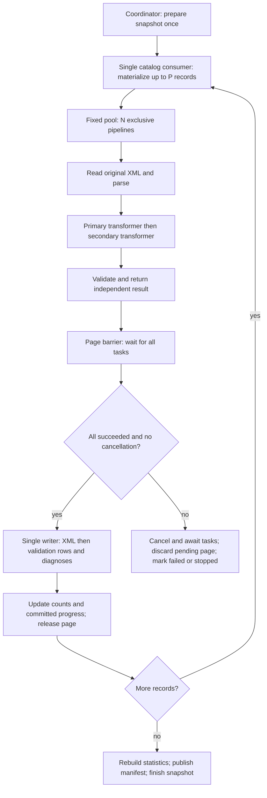

# Future Validator and Transformer Parallelization

**Status:** design proposal supported by source inspection; not implemented.

**Review date:** 2026-10-10.

## Purpose and conclusion

This document consolidates the evidence about current validation and transformation, the proposed parallel processing of records within a page, and the changes needed to implement it. It is the single document produced for this investigation.

The proposal is feasible with one coordinator per snapshot: materialize a bounded page, process its records with a fixed number of threads, collect independent results in memory, wait for the whole page, and persist results serially before starting the next page. Existing mutable rules, shared XML helpers, metadata connections, page hooks, and persistence boundaries require changes. Source inspection establishes a plausible implementation path; it does not establish concurrency safety or a measured speedup.

## Current behavior

`ValidationWorker` extends `BaseIteratorWorker`. The base loop consumes one iterator and calls `processItem()` sequentially. Its default `pageSize` is 1000, but validation's `prePage()` and `postPage()` are empty. These pages are progress/hook boundaries, not SQL pagination or durable checkpoints. Validation does not use the indexing-oriented `ValidationRecordPaginator`.

The observed lifecycle is:

1. Select the latest harvested snapshot, mark validation started, invalidate the previous manifest, and calculate the pipeline fingerprint. The fingerprint includes validation rules, ordered transformers, network metadata, and diagnosis settings.
2. For an incremental action, attempt to copy the parent's validation database. Reuse requires a valid parent, a readable compatible FULL/INCREMENTAL manifest, a matching fingerprint, and a successful copy. Clear inherited change markers in the copied database.
3. With reusable results, read changed catalog entries, write deleted entries as tombstones, and process active N/U entries. Otherwise create fresh validation results and process every non-deleted record. Unchanged inherited rows remain available in incremental mode.
4. For each record, read original XML using its metadata hash, parse it, apply primary and secondary transformers in order, and run validation rules. Store transformed XML when needed, set its published hash and timestamp, add the validation observation, and increment snapshot counts.
5. The statistics service buffers validation rows and diagnosis occurrences, flushing when it reaches 1000 records. Record persistence uses UPSERT by identifier hash and replaces previous occurrences.
6. On successful completion, flush remaining results, rebuild counts from all active validation rows, write statistics, publish a FULL/INCREMENTAL manifest, and finish validation. Failures or cancellation must prevent publication as a completed validation. The worker closes catalog and validation resources in its lifecycle cleanup.

Worker-level concurrency is separate. The legacy TaskManager limits concurrent workers through `taskmanager.concurrent.tasks` (documented default 4), execution context, and serial lanes. The validation bean is prototype and does not explicitly set `serialLaneId` (base default -1). The legacy network context serializes repeated executions for that context. Flowable has a separately declared execution path. None of these settings makes records within one validation worker parallel.

## Source map

Paths below are relative to the repository root. Line numbers refer to the reviewed source and may move after edits.

| File | Responsibility / evidence |
|---|---|
| `lareferencia-core-lib/src/main/java/org/lareferencia/core/worker/validation/ValidationWorker.java` | Snapshot preparation and full/incremental selection (94–301), mixed processing/persistence in `processItem()` (314), failure, cancellation, cleanup and completion (416 onward). |
| `lareferencia-core-lib/src/main/java/org/lareferencia/core/worker/BaseIteratorWorker.java` | Sequential iteration, page size and hooks (42–90), iterator setup (139). |
| `lareferencia-core-lib/src/main/java/org/lareferencia/core/worker/validation/ValidatorImpl.java` | Sequential rule evaluation and validity based on mandatory rules. |
| `lareferencia-core-lib/src/main/java/org/lareferencia/core/worker/validation/TransformerImpl.java` | Ordered transformations within each record. |
| `lareferencia-core-lib/src/main/java/org/lareferencia/core/service/validation/ValidationService.java` | Construction of runtime validators and transformers from stored models (99, 144). |
| `lareferencia-core-lib/src/main/java/org/lareferencia/core/repository/catalog/OAIRecordCatalogRepository.java` | Catalog selection (104–120), stream/cursor ownership (439 onward). |
| `lareferencia-core-lib/src/main/java/org/lareferencia/core/metadata/MetadataStoreFSImpl.java` | XML storage by hash; independent gzip file reads (238). |
| `lareferencia-core-lib/src/main/java/org/lareferencia/core/metadata/MetadataStorePerNetworkSQLiteImpl.java` | One cached metadata connection per network (85); XML read/write methods (132, 156). |
| `lareferencia-core-lib/src/main/java/org/lareferencia/core/metadata/MetadataStorePerNetworkH2Impl.java` | One cached metadata connection per network (76); XML read/write methods (125, 149). |
| `lareferencia-core-lib/src/main/java/org/lareferencia/core/metadata/MedatadaDOMHelper.java` | Shared parser map and XML factories (64 onward, `obtainThreadBuider()`). |
| `lareferencia-core-lib/src/main/java/org/lareferencia/core/metadata/SnapshotStoreSQLImpl.java` | Snapshot state and counter updates, including increments (512, 538). |
| `lareferencia-core-lib/src/main/java/org/lareferencia/core/repository/validation/ValidationDatabaseManager.java` | Create/copy/migrate validation databases and manage snapshot data sources. |
| `lareferencia-core-lib/src/main/java/org/lareferencia/core/repository/validation/RecordValidationRepository.java` | Dynamic rule columns, row UPSERT and deletion of previous occurrences (106), tombstones. |
| `lareferencia-core-lib/src/main/java/org/lareferencia/core/repository/validation/RuleOccurrenceRepository.java` | Diagnosis inserts in a separate transaction (68). |
| `lareferencia-core-lib/src/main/java/org/lareferencia/core/service/validation/ValidationStatisticsSQLiteService.java` | Prototype service (64), mutable observation buffers (183), completion/count rebuilding (253), private flush (504). |
| `lareferencia-core-lib/src/main/java/org/lareferencia/core/service/validation/ValidatorFingerprintService.java` | Pipeline compatibility fingerprint for incremental reuse. |
| `lareferencia-core-lib/src/main/java/org/lareferencia/core/service/validation/ValidationManifestStore.java` | Completed result scope and fingerprint manifest. |
| `lareferencia-core-lib/src/main/java/org/lareferencia/core/task/TaskManager.java` | Legacy worker concurrency, execution contexts and serial lanes. |
| `lareferencia-lrharvester-app/config/beans/validation.actions.xml` | Legacy incremental action, diagnosis option and prototype worker. |
| `lareferencia-lrharvester-app/config/processes/validation.bpmn20.xml` | Flowable validation path. |
| `lareferencia-lrharvester-app/config/application.properties.d/05-harvester.properties` | Global task concurrency configuration. |
| `lareferencia-lrharvester-app/config/application.properties.d/02-metadata.properties` | Metadata backend configuration examples; actual deployment selection was not inspected. |
| `pom.xml` | Java 17 configuration (46 onward). |
| `docs/ISSUE_INCREMENTAL_RECORD_PROCESSING.md` | Existing supporting documentation for the incremental contract. |

## Storage boundaries

`store.basepath` and `PathUtils.getSnapshotPath(...)` determine snapshot paths:

- Catalog: `<snapshot>/catalog/catalog.db`.
- Validation rows and occurrences: `<snapshot>/validation/validation.db`.
- Completion provenance: `<snapshot>/validation/validation-manifest.json`.
- Original/published XML: hash-addressed `IMetadataStore`, using FS, H2 or SQLite according to configuration. The reviewed implementations organize metadata by network; XML storage is distinct from the snapshot validation database.
- Snapshot metadata, status and counts: `ISnapshotStore`, backed by platform SQL persistence.

Incremental reuse copies parent validation results into the new snapshot. Preparation, tombstone handling, final counts and manifest publication must remain coordinated once per snapshot. Multiple independent validation workers for the same snapshot would compete over these responsibilities and resource cleanup.

## Concurrency findings

The following paths are relative to `lareferencia-core-lib/src/main/java/org/lareferencia/core/`.

| Component | Observed evidence | Required design response |
|---|---|---|
| `repository/catalog/OAIRecordCatalogRepository.java:439` | A stream owns one ResultSet, connection and stateful iterator. Reviewed SELECT statements have no ORDER BY. | One consumer materializes the page. Do not share the cursor across threads or assume stable order between runs. Parallel SQL reads need independent queries with explicit, non-overlapping partitions. |
| `metadata/MetadataStoreFSImpl.java:238` | Each XML read opens local gzip streams and returns a String. | Independent reads of already published files fit the proposal structurally. Keep paths/configuration stable; measure storage throughput. |
| `metadata/MetadataStorePerNetworkSQLiteImpl.java:85` and `MetadataStorePerNetworkH2Impl.java:76` | A ConcurrentHashMap stores one Connection per network. Only connection acquisition is synchronized; queries execute outside that lock. | The map does not provide independent readers. Use a bounded connection pool with exclusive ownership per operation/task for actual parallel reads, or preload XML serially in the first version. |
| `service/validation/ValidationService.java:99,144` | Creates new pipeline containers and deserializes new rule instances. | Build one exclusive pipeline per processing thread. Build them from model configuration on the coordinator to avoid concurrent access to JPA entities and lazy collections. |
| `worker/validation/transformer/RegexTranslateRule.java:109` | Mutates instance fields `existingValues`, `occr` and `replace` during transformation. | Shared instances mix record state. Isolate pipelines or move scratch state into local variables. |
| `worker/validation/transformer/RemoveDuplicateOccrsRule.java:77`, `RemoveDuplicateVocabularyOccrsRule.java:82`, `FieldContentPriorityTranslateRule.java:105` | Store sets/lists as fields and mutate them per record. Some lists retain DOM nodes until later calls. | Isolate the entire pipeline initially; localize/clear scratch state to reduce DOM retention. |
| `worker/validation/validator/FieldExpressionValidatorRule.java:66` and `FieldExpressionEvaluator.java:101` | A retained evaluator replaces its `evaluationResults` list for each evaluation. | An evaluator must be exclusive to one thread. A new list per evaluation does not make concurrent use safe. |
| `metadata/MedatadaDOMHelper.java:64` | Static HashMap of builders keyed by thread name; shared static DocumentBuilderFactory/TransformerFactory and namespace context. | Replace the map with safely initialized ThreadLocal builders. Thread names do not guarantee unique identity. Isolate or protect factory use and assess shared namespace access. Pipeline isolation alone does not resolve this global state. |
| `worker/validation/transformer/IdentifierRegexRule.java:87` | Changes the record identifier. Other rules change the record's DOM and read snapshot/network attributes. | Give each task exclusive record/DOM ownership; return record changes and preserve the original record ID used as the validation key. Snapshot configuration remains read-only during tasks. |
| `worker/validation/validator/URLExistFieldValidatorRule.java:90` | HTTP HEAD calls do not configure connect/read timeouts in the reviewed method; redirect settings are changed globally. | Define timeouts, connection cleanup and cancellation behavior. A slow request can hold the page barrier indefinitely. Consider a separate concurrency limit for remote checks; instance isolation does not remove static side effects. |
| `worker/validation/ValidationWorker.java:314` | Reuses `reusableValidationResult` and `wasTransformed`, and mixes XML reads, transformations, validation, XML writes, statistics and counts. | Split processing from persistence. Results and transformation flags must be local/exclusive; tasks must not call mutable persistence services. |
| `service/validation/ValidationStatisticsSQLiteService.java:183,504` | Mutable buffers/currentStats; auto-flush at 1000 observations; private flush method. | Keep the service on the writer/coordinator thread. Add an explicit page persistence/flush API so every completed page, including a short page, is written. |
| `repository/validation/RecordValidationRepository.java:106` and `RuleOccurrenceRepository.java:68` | Previous occurrences are deleted and rows upserted in one transaction; new occurrences are inserted in another. | Serial writing alone is not atomic. Share a connection/transaction if validation rows and diagnoses must commit together per page. |
| `metadata/SnapshotStoreSQLImpl.java:512,538` | Mutates snapshot objects and tracks updates. Final statistics rebuild counts from active database rows. | Keep updates on the coordinator. Per-page count updates require an additional API; final counts must still include inherited incremental results. |
| `worker/BaseIteratorWorker.java:69` and `ValidationWorker.java:416` | postPage runs at full page boundaries only; worker finally blocks close resources. | Explicitly process the final partial page and wait for all tasks before closing resources. Merely deferring work to postPage would leave the last partial page unprocessed. |

A snapshot has one shared `validation.db`. WAL and UPSERT do not establish the benefit or safety of multiple writers. Duplicate processing of a key would also compete over diagnosis replacement. A single writer avoids introducing these competing writes.

## Proposed architecture

Let P be the maximum records per page and N the number of processing threads. Start with one page in flight and a fixed pool; keep both values configurable and bounded.

### Preparation

Run existing snapshot selection, manifest invalidation, fingerprint calculation, incremental copy and tombstone handling once. Capture pipeline configuration and construct N independent primary/secondary transformers and validators before dispatching work. Each processing thread uses its pipeline exclusively. Preserve rule order inside each record; parallelize records, not dependent transformations within a record.

### Input and parallel reads

The catalog supplies record fields and the original XML hash; XML is subsequently read from the metadata store. These are different reads.

Initially keep catalog consumption sequential and parallelize XML reads plus parsing/transformation/validation where the backend supports independent reads. For current SQLite/H2 metadata implementations, either adapt connection ownership first or preload page XML serially and parallelize computation only.

Parallel catalog SQL queries are a separate optimization. They would need explicit partitioning, independent connections, coverage without duplicates, and preservation of full/incremental filters. The current stream should not be shared or made parallel as a shortcut. Keep this optimization pending until measurements show catalog iteration matters.

### Independent processing results

Split the existing mixed method conceptually into `processRecord(input, pipeline)` and `persistPage(results)`; these names describe proposed APIs.

Each task returns an independent result containing:

- Original record ID/key and position within the page.
- Final identifier and other record changes, including processing timestamps.
- Valid/transformed flags and rule outcomes keyed by rule ID.
- Diagnosis occurrences as copied value data when enabled.
- Transformed XML when needed; otherwise retain the original metadata hash.

Do not return a reusable ValidatorResult that a subsequent task resets before persistence. Prefer values and owned list copies rather than references to mutable rule objects, evaluators or DOMs. Release task DOMs as soon as serialized results are available. Localized rule scratch state also prevents pipelines retaining previous DOMs.

Processing tasks read XML, parse, transform and validate. The coordinator performs XML writes, statistics aggregation, snapshot count/status changes, persistent logging and finalization. Construct transformed timestamps during processing and carry them into persistence; do not substitute the flush time.

### Barrier and serial persistence

Wait for every task in the page before starting its writes. Persist in the input order captured for that run, regardless of task completion order. This is not a guarantee of stable SQL order across runs.

For each transformed result, store XML and obtain its hash before creating the validation row that references it. Persist rows and diagnoses through an explicit page API, update counters/progress, then release page memory and continue. Process the final page even when it contains fewer than P records. Handle empty input without creating spurious tasks or skipping finalization.

Encapsulate the page loop in validation or a new batch abstraction. A global change to BaseIteratorWorker could affect other workers' hooks and progress semantics. Java 17 supports the required fixed executor; this design does not require virtual threads.

## Failure, cancellation and resource ownership

If any task fails before persistence, stop dispatch, cancel pending tasks, await their termination, discard the unwritten page and mark the snapshot failed from the coordinator. For user cancellation, mark it stopped unless an execution failure has occurred. Worker threads must not independently finalize state or close shared resources.

This changes the partial-result behavior: the current sequential worker can persist records preceding a failing record; the proposal discards the entire pending page. Earlier completed pages may remain persisted, but a failed/stopped snapshot must not receive a completed manifest.

Interruption alone may not terminate blocking HTTP calls. Timeouts and resource cleanup must make cancellation bounded. Shutdown and await the executor before closing catalog/validation resources. Finalization occurs once after all pages have been written and cancellation has been checked.

## Transactions and recovery

A single writer prevents concurrent mutation of buffers and counters; it does not provide atomicity across storage systems. XML storage, validation SQLite and snapshot SQL are separate destinations.

For atomic validation rows and diagnoses within validation.db, refactor repository operations to share one connection and transaction per page, including deletion of old occurrences. Current methods commit those steps separately. Decide explicitly whether this stronger guarantee is part of the initial implementation.

Even that transaction cannot include FS/H2/SQLite XML writes and platform snapshot SQL automatically. A failure after storing XML but before committing validation may leave unreferenced blobs. Do not publish the snapshot as completed after such a failure. Counts should remain recoverable from committed active validation rows, as current completion already rebuilds them.

The first version can retain the existing full/incremental restart behavior. It must not claim resumable page checkpoints: there is no durable page checkpoint or explicit catalog order today. Resuming from committed pages would require a separate ordering/checkpoint contract and recovery design. Preserve incremental N/U/D handling, inherited unchanged results and fingerprint compatibility throughout.

## Memory and performance limits

Page memory includes completed transformed XML and diagnoses, up to N active DOMs, any preloaded original XML, and configuration/vocabulary copies in N pipelines. A record-count limit does not bound bytes. Measure real sizes and introduce a byte budget if needed. Avoid loading the whole snapshot or queueing multiple pages in the first version.

Approximate page time with independent XML reads is:

`T_page = T_catalog + T_parallel_processing_makespan + T_serial_persistence`

The processing makespan includes XML read, parsing, both transformers and validation, and is determined by scheduling and the slowest tasks. With serial XML preload, add preload time to the serial portion. Serial writes, storage throughput, remote checks and page barriers limit speedup; N threads do not imply an N-fold improvement.

Measure catalog read, XML read, parse, transform, validation, XML write, validation database persistence, peak memory and cancellation latency separately. Compare N=1 with several bounded N values before selecting defaults. Several concurrently running workers multiply total threads and connection demand; internal concurrency must fit an application-wide resource budget.

## Implementation sequence and validation plan

1. Separate record processing from persistence while preserving N=1 behavior and existing full/incremental lifecycle.
2. Correct global XML helper ownership and construct pipelines exclusively per thread.
3. Introduce explicit bounded pages, independent results, page barriers, final partial-page handling and coordinated cancellation.
4. Introduce explicit page persistence/flush; decide and implement the required transaction boundary for rows and occurrences.
5. Enable parallel XML reads for supported backends; adapt SQLite/H2 connection ownership where required.
6. Compare sequential and parallel behavior on full and incremental snapshots: keys, final identifiers, valid/transformed flags, rule outcomes, diagnoses, published metadata and counts. Compare XML/hashes for deterministic pipelines; account for timestamps and live HTTP results that can vary between runs.
7. Exercise empty input, short final pages, task failure, persistence failure and cancellation. Confirm no completed manifest on failure/stop, correct tombstones/inherited rows, independent result lifetimes and resource closure only after tasks finish.
8. Measure throughput and memory before choosing page/thread defaults or pursuing parallel catalog queries.

## Remaining decisions and review scope

Implementation must select page size, thread count, byte budget, metadata connection strategy, transaction guarantees and HTTP timeout/cancellation policy. Deployment configuration and actual active rule sets still need inspection before tuning. Page resumability and overlapping page stages require additional designs if pursued later.

This document records repository source inspection on the review date. No runtime implementation, concurrency tests, load measurements or deployment verification were performed. The listed findings are concrete source evidence; the architecture and implementation sequence are proposed work.
