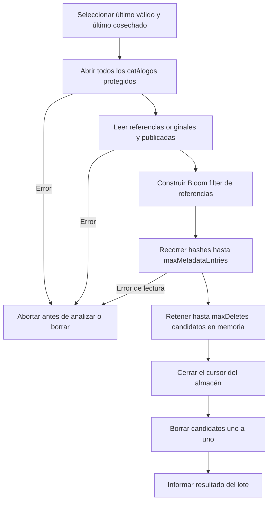

# Evaluación de la limpieza de metadatos y snapshots

Fecha: 18 de noviembre de 2026. Alcance: código del workspace, configuración de acciones, previsualización del admin y auditoría de existencia de archivos del snapshot `4193` de BR en el servidor de harvesting.

## Resultado de la evaluación

Se confirmó un defecto crítico: la limpieza podía clasificar metadatos referenciados como huérfanos cuando los catálogos protegidos no estaban abiertos en memoria. El repositorio devolvía un stream vacío y la limpieza continuaba. Hay una corrección local con pruebas que abre todos los catálogos protegidos y exige que sus referencias se puedan leer completamente antes de analizar candidatos o borrar.

La auditoría completa encontró **1.456.268 hashes únicos referenciados por `4193` sin archivo de metadatos**. El snapshot conserva sus bases de datos, pero parte de su contenido XML está ausente. La corrección del cleaner evita repetir ese fallo; no recupera los archivos perdidos.

También se identificaron problemas de cancelación, retención, coste, observabilidad y manejo de errores en los cleaners relacionados. Se detallan como hallazgos pendientes: no se consideran resueltos por la corrección de apertura de catálogos.

## Componentes y responsabilidades

| Componente | Responsabilidad actual |
| --- | --- |
| `NetworkCleanWorker`, modo limpieza | Elimina catálogos y validaciones de snapshots antiguos, conserva el último válido y el último cosechado, y marca o elimina sus filas de snapshot. |
| `NetworkCleanWorker`, modo borrado completo | Recorre todos los snapshots y elimina la fila de la red. No constituye una transacción atómica sobre archivos, bases de datos e índices. |
| `MetadataOrphanCleanupWorker` | Escoge los snapshots protegidos y ejecuta la limpieza limitada del almacén compartido de metadatos de una red. |
| `MetadataOrphanAnalysisService` | Recoge hashes referenciados, construye un Bloom filter, recorre el almacén y prepara los candidatos antes de borrarlos. También sirve a la previsualización. |
| Repositorio de cosecha | Proporciona `original_metadata_hash` desde `catalog.db`. |
| Repositorio de validación | Proporciona `published_metadata_hash` desde `validation.db`. |
| `IMetadataStore` | Recorre y borra hashes en FS, SQLite o H2. |
| API y Admin UI | Ofrecen una previsualización y la ejecución de la acción configurable. No existe un plan persistido que vincule una previsualización con el borrado posterior. |

La acción de limpieza de huérfanos está deshabilitada por defecto mediante `enabledByDefault=false`. Esto reduce la exposición inicial, pero una vez habilitada su seguridad depende del código y del estado del almacenamiento.

## Flujo actual de huérfanos



El diagrama incluye la corrección local. Antes del cambio, la apertura explícita faltaba y la ausencia de conexiones podía parecer un catálogo vacío.

### Qué se conserva

Se incorporan los hashes originales de cosecha y los publicados por validación de los snapshots seleccionados. La selección habitual es el último snapshot válido y el último cosechado; si son el mismo, se protege una sola vez. No se excluyen referencias de registros eliminados cuando tienen hash: esto conserva más datos y no causa pérdida de referencias.

El Bloom filter usa una probabilidad objetivo de falso positivo del 1 %. Si se cargan todas las referencias correctamente, un falso positivo retiene un huérfano adicional; no elimina una referencia protegida. El incidente se origina en referencias no cargadas, no en esa probabilidad.

### Qué significa «huérfano» aquí

El criterio implementado es «hash no referenciado por los snapshots protegidos». Un hash utilizado exclusivamente por un snapshot histórico que todavía esté visible puede resultar candidato. Es necesario acordar si esos históricos deben seguir siendo recuperables y cómo se coordina la limpieza de snapshots con la limpieza de metadatos.

### Límites

- `maxMetadataEntries` limita el recorrido del almacén de hashes, no las lecturas previas de los catálogos protegidos.
- `maxDeletes` limita cuántos hashes candidatos se guardan para intentar borrarlos.
- `progressEvery` regula los mensajes del worker; el callback del servicio se invoca para cada hash y borrado.
- El código actual incrementa el contador antes de comprobar el límite. Por eso un límite de 5.000.000 puede informar `scanned=5000001`; el hash adicional no se clasifica ni se añade a borrados.
- `deleteLimitReached` es verdadero cuando se observan más candidatos que los que caben en el lote. No expresa por sí solo que la limpieza global haya terminado.

## Incidente de BR y snapshot 4193

Se accedió al servidor por SSH para leer los catálogos y comprobar archivos. No se pausó el harvester, no se modificaron los metadatos y no se ejecutaron acciones de restauración o limpieza. Los catálogos de auditoría se abrieron con URI SQLite `mode=ro` y `PRAGMA query_only=ON`.

Las bases existentes son `BR/snapshots/snapshot_4193/catalog/catalog.db` y `BR/snapshots/snapshot_4193/validation/validation.db`. Para cada hash se comprobó el archivo esperado bajo `BR/metadata/{H1}/{H2}/{H3}/{hash}.xml.gz`, usando los tres caracteres de partición en mayúsculas, igual que `MetadataStoreFSImpl`.

### Resultado completo

| Medida | Resultado |
| --- | ---: |
| Filas del catálogo de cosecha | 4.307.594 |
| Filas sin hash original | 143.816 |
| Referencias originales con hash | 4.163.778 |
| Referencias originales sin archivo | **728.726 (17,502 %)** |
| Referencias publicadas con hash | 4.163.778 |
| Referencias publicadas sin archivo | **728.178 (17,488 %)** |
| Referencias publicadas de registros válidos no eliminados | 2.872.830 |
| Referencias publicadas válidas sin archivo | **502.572 (17,494 %)** |
| Hashes únicos referenciados, combinando ambos catálogos | 8.323.963 |
| Hashes únicos referenciados sin archivo | **1.456.268** |

Las referencias originales ausentes y las publicadas ausentes pertenecen a registros no eliminados. Los conteos de referencias no equivalen a archivos únicos: se realizó un cruce separado para obtener la última fila. Las 143.816 filas sin hash no se clasificaron como archivos perdidos en esta auditoría.

Datos completos, ejemplos y limitaciones: [resultado JSON de la auditoría](METADATA_CLEANUP_REVIEW_2026-11-18.json).

### Historial observado

El log del servidor contiene cuatro ejecuciones completadas el 17 de noviembre de 2026:

| Fin, hora de Madrid (CET) | Escaneados informados | Candidatos | Eliminados |
| --- | ---: | ---: | ---: |
| 17:11:06 | 5.000.001 | 5.000.000 | 1.000.000 |
| 20:40:24 | 5.000.001 | 5.000.000 | 1.000.000 |
| 21:20:01 | 5.000.001 | 5.000.000 | 1.000.000 |
| 22:36:23 | 5.000.001 | 5.000.000 | 1.000.000 |

En conjunto registran cuatro millones de eliminaciones exitosas. No prueban cuatro millones de hashes distintos, ni identifican qué ejecución eliminó cada archivo que falta hoy. El log del 18 de noviembre muestra explícitamente que faltaba el DataSource de `4193` antes de clasificar todos los hashes observados como candidatos.

La secuencia es consistente con el defecto confirmado de referencias no cargadas. Para atribuir la pérdida por ejecución se necesitarían manifiestos de borrado, backups o registros adicionales.

### Límites de la auditoría

La comprobación detecta ausencia de archivos, no contenido corrupto: los archivos existentes no se descomprimieron ni se verificó su hash. Las bases SQLite se leen de forma consistente por consulta, pero el recorrido del filesystem y las consultas separadas no constituyen un snapshot atómico de todo el almacenamiento. La ausencia observada no establece por sí sola la fecha ni la causa de cada eliminación.

## Hallazgos priorizados

| Prioridad | Hallazgo | Efecto | Estado |
| --- | --- | --- | --- |
| P0 | Catálogos no abiertos tratados como vacíos | Puede borrar datos utilizados por snapshots protegidos. | **Corregido localmente**, pendiente de despliegue. |
| P0 | Snapshot 4193 incompleto | Lectura, revalidación o reindexación pueden fallar en los registros afectados. | Confirmado; recuperación pendiente. |
| P1 | Cancelación no comprobada en bucles | Una solicitud de detener puede dejar el recorrido o el borrado ejecutándose hasta acabar o encontrar un error. | Pendiente. |
| P1 | Protección limitada a dos snapshots | Históricos aún visibles pueden perder su XML exclusivo. | Requiere política de retención explícita. |
| P1 | Errores absorbidos en `NetworkCleanWorker` | Puede informar finalización pese a fallos; en borrado completo puede intentar eliminar la red después de errores al limpiar snapshots. | Pendiente. |
| P1 | Exclusión mutua limitada al proceso | `TaskManager` serializa por contexto de red dentro de la JVM; no hay un candado distribuido en este servicio para otros procesos con acceso al almacén. | Revisar despliegues múltiples y procesos externos. |
| P2 | Lista de candidatos en memoria | Millones de objetos `String` pueden consumir cientos de MB, además del filtro y los cursores. | Pendiente de lotes o plan persistido. |
| P2 | Sin cursor de reanudación | Cada ejecución empieza otro recorrido; con un límite pequeño puede volver a visitar un prefijo protegido y no alcanzar huérfanos posteriores. | Pendiente. |
| P2 | Dos lecturas completas de referencias | Cuenta todas las filas y luego vuelve a leerlas para construir el filtro; `SELECT *` materializa datos que no necesita para los hashes. | Optimización pendiente. |
| P2 | Previsualización síncrona y sin límite | Una petición HTTP puede recorrer millones de registros y archivos; puede agotar tiempos de espera o recursos. | Pendiente de trabajo asíncrono con límites. |
| P2 | Apertura de lectura con efectos auxiliares | La API existente de validación puede migrar columnas al abrir; SQLite/H2 de metadatos pueden crear almacenamiento inexistente. | Requiere apertura estrictamente de consulta donde corresponda. |
| P2 | Borrado parcial sin manifiesto ni rollback global | Un error después del primer borrado deja un lote parcial; FS no puede restaurarlo transaccionalmente. | Pendiente de plan y registro de resultados. |
| P2 | `deleteMetadata=false` ambiguo | FS devuelve falso tanto si no existe como si no logra borrar; el servicio puede terminar sin distinguirlos. | Pendiente de resultado estructurado. |
| P2 | Métricas de lote insuficientes en UI | «Completed» no garantiza que ya no queden huérfanos ni indica el límite que detuvo el lote. | Pendiente. |
| P2 | Sin validación explícita de namespace homogéneo | El servicio acepta una lista arbitraria de snapshots y recorre el almacén del primero; sus llamadores actuales generan listas de una sola red. | Añadir defensa de entrada. |
| P2 | Sin comprobación integrada de integridad referencial | El cleaner detecta contenido sobrante, pero no informa hashes referenciados que ya faltan. | Añadir auditoría independiente. |

### Cancelación y concurrencia

`BaseWorker` expone `isCancellationRequested()` y `TaskManager` solicita cancelación e interrumpe el hilo. `MetadataOrphanCleanupWorker`, los bucles del servicio y `NetworkCleanWorker` no consultan esa señal. Una interrupción puede provocar un error de I/O, pero no constituye un punto de cancelación garantizado en los recorridos de FS.

Dentro de un mismo `TaskManager`, un contexto de red activo bloquea otro worker de ese contexto. Esta protección es útil, pero el servicio de análisis y el almacenamiento no adquieren un bloqueo compartido entre JVM, comandos externos o acceso directo. Tampoco se conserva un plan de borrado que pueda verificarse contra un cambio de snapshots entre preparación y ejecución.

### Diferencias entre almacenamientos

- **FS:** borra un `.xml.gz` por hash. No hay transacción de lote ni recuperación de los archivos desde el catálogo. El espacio se recupera al eliminar archivos, sujeto al filesystem y posibles descriptores abiertos.
- **SQLite por red:** usa una conexión cacheada por red y un `DELETE` por hash. El tamaño del archivo no tiene por qué reducirse tras los borrados; páginas libres pueden quedar para reutilización. No se ejecuta `VACUUM` en esta acción.
- **H2 por red:** también realiza borrados individuales y utiliza conexiones cacheadas. No debe inferirse espacio físico liberado a partir del contador `deleted`.
- El servicio ya separa la recolección de candidatos del borrado para cerrar el cursor de hashes antes de mutar la tabla. Ese diseño evita borrar mientras se itera el mismo cursor, pero no da atomicidad al lote.

## Corrección implementada

1. Antes de contar o recorrer metadatos, se abren los catálogos de cosecha y validación de **todos** los snapshots protegidos.
2. Se agregan lecturas requeridas a ambos repositorios. Si la conexión deja de estar disponible, lanzan un error en lugar de devolver un stream vacío.
3. Las referencias se leen completamente con estas APIs, tanto para estimar el filtro como para llenarlo.
4. La limpieza y la previsualización abortan si, tras leer todos los catálogos, el total de referencias originales y publicadas cargadas es cero.
5. Si falla la apertura o la lectura de cualquiera de los catálogos, no se llama al recorrido del almacén ni a `deleteMetadata`. Un error inesperado durante el recorrido del almacén también impide pasar a los borrados preparados.

Esto no promete rollback si falla un borrado después de que otros ya hayan ocurrido. Tampoco cambia todavía la política de retención ni añade cancelación cooperativa.

Si el último snapshot cosechado todavía no tiene una base de validación legible, la limpieza aborta de forma conservadora. Para permitir ese caso en el futuro habría que distinguir explícitamente «snapshot aún no validado» de «validación esperada pero inaccesible»; no debe deducirse del mero hecho de que falte el archivo.

## Verificación realizada

Se ejecutaron **43 pruebas**, sin fallos, de:

- `MetadataOrphanAnalysisServiceTest`: 11 casos nuevos sobre ausencia de hashes, apertura de bases cerradas, varios snapshots protegidos, catálogos ausentes o corruptos, streams estrictos, error durante lectura y error durante escaneo.
- `OAIRecordCatalogRepositoryIncrementalTest`: 2 casos existentes.
- `MetadataStoreFSImplTest`: 20 casos existentes.
- `MetadataStoreIntegrationTest`: 10 casos existentes de filesystem temporal.

```bash
mvn -B -ntp -pl lareferencia-core-lib -am \
  -Dtest=MetadataOrphanAnalysisServiceTest,OAIRecordCatalogRepositoryIncrementalTest,MetadataStoreFSImplTest,MetadataStoreIntegrationTest \
  -Dsurefire.failIfNoSpecifiedTests=false test
```

Se usaron SQLite y directorios temporales para las pruebas; ninguna prueba destructiva se ejecutó contra producción. No se ejecutó la suite completa de la plataforma ni se probaron borrados contra H2 o SQLite de producción. La revisión de esos backends fue estática.

## Propuesta de evolución

### Antes de volver a habilitar borrados automáticos

- Desplegar la corrección de preparación estricta y verificar qué snapshots protege cada ejecución.
- Incorporar cancelación cooperativa durante preparación, escaneo y antes de cada borrado.
- Acordar la política de históricos y proteger todos los snapshots que sigan prometiendo acceso a metadatos.
- Mostrar referencias originales/publicadas cargadas, namespace, límites y motivo de parada antes de cualquier borrado.
- Evaluar el estado de integridad y disponibilidad de backups de BR.

### Operación auditable

- Separar un plan de análisis de su ejecución, identificando los snapshots, versiones y candidatos.
- Guardar el plan por lotes fuera del heap y registrar intentos, eliminaciones, ausencias y errores.
- Revalidar el estado protegido antes de aplicar un plan y añadir una exclusión compartida cuando varios procesos puedan escribir.
- Ofrecer previsualización asíncrona y una auditoría independiente de referencias ausentes.
- Dar soporte a un cursor estable de reanudación por partición, evitando recorridos repetidos desde el inicio.

### Recuperación de 4193

La primera opción es restaurar los archivos faltantes desde un backup del almacén de metadatos, conservando los hashes esperados, y repetir la auditoría. Un backup de PostgreSQL por sí solo no contiene estos XML.

Si no existe backup del contenido, hará falta recuperar los registros originales desde su fuente mediante una recosecha completa o un proceso dirigido por identificadores faltantes, y regenerar la validación. Una cosecha incremental por fecha puede omitir precisamente los registros antiguos cuyos archivos se perdieron. Revalidar no recupera originales ausentes, y un índice Solr no garantiza conservar el XML necesario para reconstruirlos.

Conviene planificar la recuperación antes de reemplazar un índice que aún contenga resultados útiles: reconstruirlo a partir de un snapshot incompleto puede perder documentos que siguen visibles en la búsqueda.

## Archivos relevantes

- [Servicio de análisis y borrado](../lareferencia-core-lib/src/main/java/org/lareferencia/core/metadata/MetadataOrphanAnalysisService.java)
- [Worker de huérfanos](../lareferencia-core-lib/src/main/java/org/lareferencia/core/worker/management/MetadataOrphanCleanupWorker.java)
- [Cleaner de snapshots y redes](../lareferencia-core-lib/src/main/java/org/lareferencia/core/worker/management/NetworkCleanWorker.java)
- [Repositorio de cosecha](../lareferencia-core-lib/src/main/java/org/lareferencia/core/repository/catalog/OAIRecordCatalogRepository.java)
- [Repositorio de validación](../lareferencia-core-lib/src/main/java/org/lareferencia/core/repository/validation/RecordValidationRepository.java)
- [Configuración de acciones](../lareferencia-lrharvester-app/config/beans/cleaning.actions.xml)
- [Pruebas de la corrección](../lareferencia-core-lib/src/test/java/org/lareferencia/core/metadata/MetadataOrphanAnalysisServiceTest.java)
